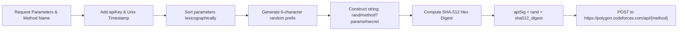
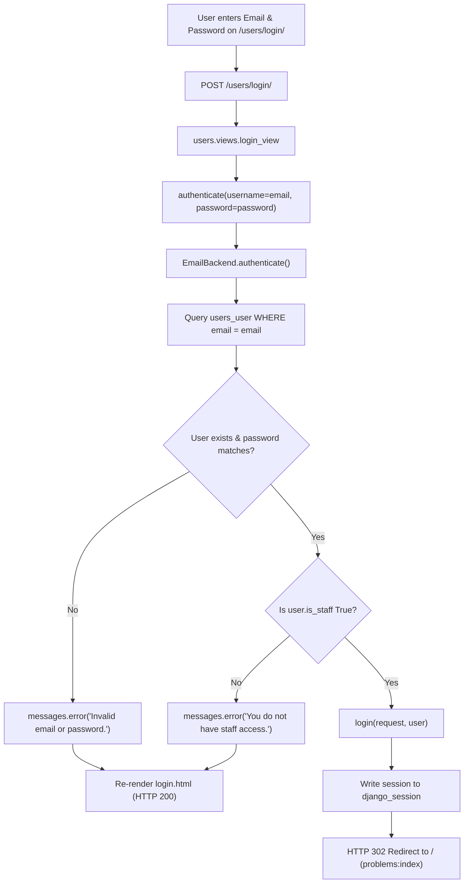
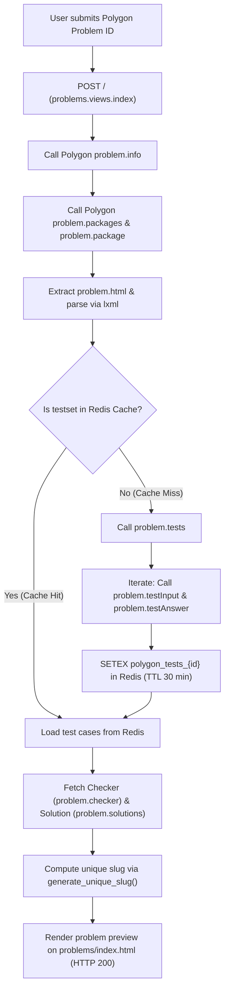
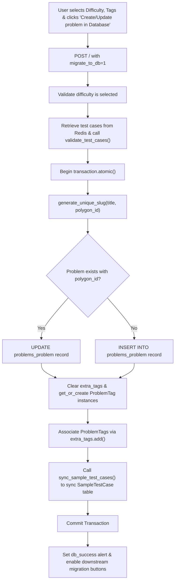
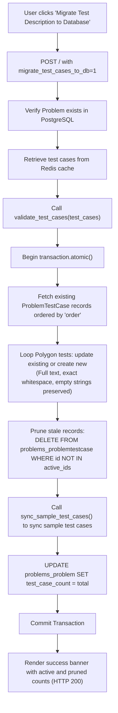

# Polygon Problem Migration System — Comprehensive Technical Documentation

---

## 1. System & Architecture Overview

The **Polygon Problem Migration System** is an enterprise-grade Django web application that automates the extraction, transformation, and migration of programming contest problems from **Codeforces Polygon** into a local relational database (**PostgreSQL**) and cloud object storage (**Google Drive** or **Azure Blob Storage**).

### High-Level Architectural Components
- **Web Layer**: Django 5.2 MVC architecture handling session authentication, request routing, and server-rendered Bootstrap 5 UI.
- **Integration Layer (`polygon_api.py`)**: Interacts with the Polygon REST API using cryptographic SHA-512 signatures (`apiSig`), downloads compiled problem packages, and parses statement HTML.
- **Caching Layer (`Redis`)**: In-memory Redis store caching full Polygon test-case arrays (`polygon_tests_{polygon_id}`) to prevent rate limiting (`HTTP 429 Too Many Requests`).
- **Persistence Layer (`PostgreSQL`)**: Relational database storing problems, tags, regular test cases, and sample test cases with strict data integrity guarantees.
- **Storage Layer (`GoogleDriveStorage.py` / `AzureTestcase.py`)**: Dual-provider cloud storage abstraction implementing idempotent file uploads in standardized hierarchies (`test_cases/{problem_id}/{test_number}`).

---

## 2. Project Setup, Environment & Dependency Architecture

To set up this project cleanly on my local machine and prepare it for future containerization, I started by establishing an isolated Python environment and installing all required system dependencies.

### 1. Create and Activate Virtual Environment
```bash
# Navigate to the project root
cd PolygonMigrationAssignment

# Create an isolated virtual environment
python -m venv PolygonMigration/.venv

# Activate on Windows (PowerShell)
.\PolygonMigration\.venv\Scripts\Activate.ps1
# On Windows (cmd.exe): .\PolygonMigration\.venv\Scripts\activate.bat
# On Linux/macOS: source PolygonMigration/.venv/bin/activate
```

#### Why I Created a Dedicated Virtual Environment:
- **Dependency Isolation**: It prevents project packages from conflicting with system-wide Python libraries or other local projects.
- **Reproducible Requirements**: It ensures that all required packages are explicitly tracked in `requirement.txt` without accidentally relying on globally installed packages.
- **Fast & Reliable Dockerization**: When containerizing this application with Docker in the future, having a clean virtual environment ensures zero missing-dependency surprises during image build time.

---

### 2. Install Project Dependencies
```bash
python -m pip install --upgrade pip
python -m pip install -r requirement.txt
```

#### Key Libraries Installed & Their Roles:
- **Django (5.2)**: The core web framework powering the application, ORM, URL routing, session management, and server-rendered Bootstrap 5 templates.
- **psycopg2-binary**: PostgreSQL database adapter for high-performance relational persistence.
- **redis**: In-memory data store client used to cache raw Polygon test-case responses and prevent API rate-limiting (`HTTP 429 Too Many Requests`).
- **google-api-python-client**, **google-auth-oauthlib**, **google-auth-httplib2**: Official Google client libraries for Google Drive API v3 and OAuth 2.0 Web Application authorization with PKCE.
- **beautifulsoup4** & **lxml**: Fast HTML parsers used to parse compiled problem statement packages (`problem.html`).
- **azure-storage-blob**: Microsoft Azure SDK for Blob Storage operations.
- **python-dotenv**: Loads environment variables from `.env` with override enforcement.

---

### 3. Verify Package Integrity
To ensure that all installed packages are structurally intact, free of version conflicts, and correctly loaded, I executed the following verification commands:
```bash
python -m pip check
python -m pip list
```
- `python -m pip check` verified that there are no broken requirements or incompatible dependency versions.
- `python -m pip list` confirmed that all required packages (including transitive dependencies) are present.

---

### 4. Security & `.gitignore` Configuration
To keep the repository clean and prevent accidental exposure of sensitive credentials, database passwords, OAuth tokens, and build artifacts, I configured a comprehensive `.gitignore` file:

```gitignore
# Python bytecode & cache
__pycache__/
*.py[cod]
*.pyo

# Virtual environments
.venv/
venv/
env/

# Environment variables & secrets
.env
.env.*
!.env.example

# Google OAuth credentials & tokens
*client_secret*.json
*client_secrets*.json
google_drive_token.json
*token*.json
oauth_credentials.json

# IDE configurations
.vscode/
.idea/

# Local logs
*.log
```

#### Why This Is Essential:
- Prevents database passwords, Polygon API secrets, and Google OAuth client secrets from being committed to public source control.
- Keeps OAuth tokens (`google_drive_token.json`) strictly local so user session tokens and refresh tokens are never leaked.
- Excludes temporary build files, virtual environments, and bytecode caches to keep Git diffs clean and deterministic.

---

### 5. Database & Cache Connectivity Setup

#### PostgreSQL Database:
- Configured and verified local PostgreSQL running on port `5432`.
- Created database `polygon_migration` owned by user `postgres`.
- Verified that connection parameters in `.env` match:
  ```env
  DATABASE_ENGINE=django.db.backends.postgresql
  DATABASE_NAME=polygon_migration
  DATABASE_USER=postgres
  DATABASE_PASSWORD=...
  DATABASE_HOST=localhost
  DATABASE_PORT=5432
  ```

#### Redis Cache Server:
- Verified that Redis is running locally on port `6379`.
- Redis acts as a high-speed cache for raw test-case data retrieved from the Polygon API. Because Polygon enforces strict rate limits (`429 Too Many Requests`), caching test cases in Redis ensures that subsequent database migrations and preview operations do not exhaust API quotas.

---

### 6. Apply Database Migrations
Ensure PostgreSQL is running locally on port `5432` with database `polygon_migration` created:
```bash
python PolygonMigration/manage.py migrate
```

### 7. Verify Migration Status
```bash
python PolygonMigration/manage.py migrate --check
```

### 8. Create Staff Administrator
```bash
python PolygonMigration/manage.py createsuperuser
```

### 9. Run Automated Test Suite
```bash
python PolygonMigration/manage.py test problems
```

### 10. Start Development Server
```bash
python PolygonMigration/manage.py runserver 127.0.0.1:8000
```
Access the application dashboard at `http://127.0.0.1:8000/`.

---

## 3. Environment Configuration Reference

All application secrets and environment variables are loaded from `PolygonMigration/.env` using `python-dotenv` with `override=True`.

| Variable Name | Required | Supported Values / Format | Description |
| :--- | :--- | :--- | :--- |
| `SECRET_KEY` | Yes | String | Django secret key for cryptographic signing and session cookies. |
| `DEBUG` | Yes | `True` / `False` | Django debug mode. |
| `ALLOWED_HOSTS` | Yes | Comma-separated strings | Host/domain names that this Django site can serve (e.g. `localhost,127.0.0.1`). |
| `DATABASE_ENGINE` / `DB_ENGINE` | Yes | `django.db.backends.postgresql` | Database backend engine. |
| `DATABASE_NAME` / `DB_NAME` | Yes | String (e.g. `polygon_migration`) | Target PostgreSQL database name. |
| `DATABASE_USER` / `DB_USER` | Yes | String (e.g. `postgres`) | PostgreSQL database user. |
| `DATABASE_PASSWORD` / `DB_PASSWORD` | Yes | String | PostgreSQL database password. |
| `DATABASE_HOST` / `DB_HOST` | Yes | String (e.g. `localhost`, `127.0.0.1`) | PostgreSQL server host. |
| `DATABASE_PORT` / `DB_PORT` | Yes | Integer (e.g. `5432`) | PostgreSQL server port. |
| `POLYGON_API_KEY` | Yes | String | Polygon API key for request signing. |
| `POLYGON_API_SECRET` | Yes | String | Polygon API secret for SHA-512 `apiSig` hashing. |
| `REDIS_HOST` | No | String (default `localhost`) | Redis server hostname. |
| `REDIS_PORT` | No | Integer (default `6379`) | Redis server port. |
| `REDIS_PASSWORD` | No | String | Redis password (leave empty if unauthenticated). |
| `REDIS_SSL` | No | `True` / `False` | Enable SSL/TLS for Redis connections. |
| `STORAGE_PROVIDER` | Yes | `gdrive` or `azure` | Selects active cloud storage provider. Defaults to `gdrive`. |
| `GOOGLE_DRIVE_OAUTH_CLIENT_FILE` | If gdrive | File path to JSON | Path to Google OAuth 2.0 Web Application client secrets JSON. |
| `GOOGLE_DRIVE_CREDENTIALS_FILE` | If gdrive | File path to JSON | Fallback alias for OAuth client JSON path. |
| `GOOGLE_DRIVE_TOKEN_FILE` | If gdrive | File path to JSON | Destination path for persisting user refresh token (default: `google_drive_token.json`). |
| `GOOGLE_DRIVE_FOLDER_ID` | If gdrive | Google Drive alphanumeric ID | Target root folder ID where `test_cases/` will be created. |
| `GOOGLE_DRIVE_REDIRECT_URI` | If gdrive | URL | Authorized redirect URI (default: `http://localhost:8000/oauth2callback/`). |
| `AZURE_STORAGE_ACCOUNT_URL` | If azure | URL | Azure Storage account endpoint (`https://<account>.blob.core.windows.net/`). |
| `AZURE_TENANT_ID` | If azure | UUID string | Azure Active Directory Tenant ID. |
| `AZURE_CLIENT_ID` | If azure | UUID string | Azure AD Application Client ID. |
| `AZURE_USERNAME` | If azure | Email string | Azure user email. |
| `AZURE_PASSWORD` | If azure | String | Azure user password. |
| `AZURE_CONTAINER_NAME` | If azure | String | Azure Blob container name. |
| `CUSTOM_CHECKER_DIR` | No | Directory path | Working directory for compiling custom C++ checkers via `g++`. |

---

## 4. Polygon API Endpoints & Authentication Architecture

### Authentication Mechanism (SHA-512 `apiSig`)
Polygon requires every request to carry an `apiSig` query/POST parameter to authenticate callers and prevent request tampering.

#### Exact Cryptographic Signing Algorithm:
1. Append `apiKey` and `time` (current Unix timestamp in seconds) to request parameters:
   $$\text{params}[\text{'apiKey'}] = \text{POLYGON\_API\_KEY}$$
   $$\text{params}[\text{'time'}] = \lfloor\text{time}()\rfloor$$
2. Sort all parameter pairs lexicographically by key, and then by value.
3. Construct a standard URL-encoded query string (`param_str`):
   $$\text{param\_str} = \text{urlencode}(\text{sorted\_params})$$
4. Generate a random 6-character alphanumeric prefix (`rand_prefix`) using `string.ascii_lowercase + string.digits`.
5. Form the exact pre-image string to hash:
   $$\text{to\_hash} = \text{rand\_prefix} + \text{"/"} + \text{method\_name} + \text{"?"} + \text{param\_str} + \text{"\#"} + \text{POLYGON\_API\_SECRET}$$
6. Calculate the SHA-512 hex digest of `to_hash` encoded as UTF-8:
   $$\text{sha512\_hash} = \text{SHA512}(\text{to\_hash}.\text{encode}(\text{'utf-8'})).\text{hexdigest}()$$
7. Concatenate the prefix and the hex digest to form `apiSig`:
   $$\text{apiSig} = \text{rand\_prefix} + \text{sha512\_hash}$$



### Actual Polygon API Methods Used

| Method Name | HTTP Method | Parameters | Return Format | Purpose in Implementation |
| :--- | :--- | :--- | :--- | :--- |
| `problem.info` | POST | `problemId` | JSON | Retrieves title, time limit (ms), memory limit (MB), and interactivity flag. |
| `problem.statements` | POST | `problemId` | JSON | Lists available languages and statement formats. |
| `problem.packages` | POST | `problemId` | JSON | Lists compiled problem packages to identify the latest standard revision. |
| `problem.package` | POST | `problemId`, `packageId`, `type` | Binary ZIP | Downloads the compiled package ZIP containing rendered `problem.html`. |
| `problem.tests` | POST | `problemId`, `testset` | JSON | Enumerates test cases in testset with metadata (`index`, `useInStatements`, `manual`). |
| `problem.testInput` | POST | `problemId`, `testset`, `testIndex` | Plain text | Fetches exact raw input for test case `testIndex`. |
| `problem.testAnswer` | POST | `problemId`, `testset`, `testIndex` | Plain text | Fetches exact expected output for test case `testIndex`. |
| `problem.checker` | POST | `problemId` | JSON / String | Identifies checker name and type (e.g. `std::ncmp.cpp` or custom `check.cpp`). |
| `problem.viewFile` | POST | `problemId`, `type`, `name` | Plain text | Fetches custom checker C++ source code (`type='source'` or `type='resource'`). |
| `problem.updateWorkingCopy` | POST | `problemId` | JSON | Updates the working copy to ensure the latest solutions are accessible. |
| `problem.solutions` | POST | `problemId` | JSON | Enumerates solutions; filters for main accepted solution (`tag='MA'`). |
| `problem.viewSolution` | POST | `problemId`, `name` | Plain text | Fetches primary accepted solution source code for preview and submission testing. |

---

## 5. Detailed End-to-End Workflows

---

### Workflow 1: User Login & Staff Access Control

#### User Action & UI Interaction
1. User navigates to `/users/login/` (or is automatically redirected there when accessing `/` unauthenticated).
2. User enters their registered email address and password into the login form.
3. User clicks the **Login** button.

#### Frontend Request & Payload
- **HTTP Method**: `POST`
- **URL**: `/users/login/`
- **Headers**: `Content-Type: application/x-www-form-urlencoded`
- **Payload**:
  - `csrfmiddlewaretoken`: Django CSRF token.
  - `email`: User's email string.
  - `password`: User's plaintext password.

#### Django URL & View Handling
- **Route**: `path('users/', include('users.urls'))` in `PolygonMigration/urls.py` $\rightarrow$ `path('login/', views.login_view, name='login')` in `users/urls.py`.
- **View**: `users.views.login_view`.

#### Backend Function Calls & Execution Sequence
1. `login_view(request)` checks `request.user.is_authenticated`. If already logged in, calls `logout(request)`.
2. Extracts `email` and `password` from `request.POST`.
3. Calls Django's `authenticate(request, username=email, email=email, password=password)`.
4. Django delegates to `users.backends.EmailBackend.authenticate()`:
   - Queries `User.objects.get(email=email)`.
   - Validates password hash via `user.check_password(password)` (PBKDF2 SHA-256).
   - Validates `self.user_can_authenticate(user)` (checks `is_active=True`).
5. `login_view` checks authorization: `if user.is_staff:`.
6. If staff, calls Django's `login(request, user)` to attach session state.
7. Returns `redirect('problems:index')`.

#### External API Calls
- None.

#### Database Reads & Writes
- **Read**: `SELECT * FROM users_user WHERE email = %s LIMIT 1;`
- **Write**: `INSERT INTO django_session (session_key, session_data, expire_date) VALUES (...);`

#### Redis Reads & Writes
- None.

#### Storage Operations
- None.

#### Final UI Response & Error Behavior
- **Success**: HTTP 302 Redirect to `/` (Problem Dashboard).
- **Invalid Credentials**: Renders `users/login.html` with Bootstrap alert: `"Invalid email or password."`.
- **Non-Staff User**: Renders `users/login.html` with Bootstrap alert: `"You do not have staff access."`.



---

### Workflow 2: Fetching a Problem from Polygon

#### User Action & UI Interaction
1. Authenticated staff user visits `/`.
2. Enters a numeric Polygon Problem ID (e.g. `69933`) into the "Enter Polygon Problem ID" field.
3. Clicks **Fetch Problem**.
4. JavaScript displays a loading spinner modal: `"Fetching problem data and test cases (may take 3-4 minutes)..."`.

#### Frontend Request & Payload
- **HTTP Method**: `POST`
- **URL**: `/`
- **Headers**: `Content-Type: application/x-www-form-urlencoded`
- **Payload**:
  - `csrfmiddlewaretoken`: CSRF token.
  - `problem_id`: Alphanumeric Polygon ID (e.g. `69933`).

#### Django URL & View Handling
- **Route**: `path('', include('problems.urls'))` $\rightarrow$ `path('', views.index, name='index')`.
- **Access Guard**: `@user_passes_test(lambda u: u.is_authenticated and u.is_staff, login_url='/users/login/')`.
- **View**: `problems.views.index`.

#### Backend Function Calls & Execution Sequence
1. Instantiates `PolygonAPI()`, reading `POLYGON_API_KEY` and `POLYGON_API_SECRET` from settings.
2. Checks PostgreSQL for existing problem record: `Problem.objects.filter(polygon_id=polygon_id).first()`.
3. Calls `api.get_problem_info(polygon_id)` $\rightarrow$ calls Polygon `problem.info`.
4. Calls `api.download_and_extract_package(polygon_id)`:
   - Queries `problem.packages` to find package ID of type `standard`.
   - Downloads binary package via `problem.package`.
   - Extracts ZIP to temporary directory (`tempfile.mkdtemp()`).
   - Reads `problem.html` and deletes temporary directory.
5. Calls `parse_problem_html(problem_html_content)`:
   - Uses `lxml.html` to extract `title`, `legend`, `input_format`, `output_format`, and `notes`.
6. Checks Redis Cache: `api.get_test_cases_from_redis(polygon_id)`:
   - **Cache Hit**: Returns cached test-case array.
   - **Cache Miss**: Calls `api.get_all_test_cases(polygon_id)`:
     - Calls `problem.tests` to enumerate all test indices.
     - Loops each test: calls `problem.testInput` and `problem.testAnswer`.
     - Caches result in Redis: `api.store_test_cases_in_redis(polygon_id, all_test_cases, expiry_hours=0.5)`.
7. Calls `api._make_request('problem.checker', ...)` and `api.get_custom_checker_info()`.
8. Calls `api._make_request('problem.solutions', ...)` and `api._make_plain_request('problem.viewSolution', ...)` to fetch main solution (`tag='MA'`).
9. Calls `generate_unique_slug(title, polygon_id)`.
10. Prepares truncated preview fields (`input_preview[:50]`, `output_preview[:50]`) for tabular rendering.
11. Renders `problems/index.html`.

#### External API Calls
- Polygon REST endpoints: `problem.info`, `problem.packages`, `problem.package`, `problem.tests`, `problem.testInput`, `problem.testAnswer`, `problem.checker`, `problem.solutions`, `problem.viewSolution`.

#### Database Reads & Writes
- **Read**: `SELECT * FROM problems_problem WHERE polygon_id = %s LIMIT 1;`
- **Read**: `SELECT * FROM problems_problemtag ORDER BY tag_name ASC;`
- **Write**: None.

#### Redis Reads & Writes
- **Read**: `GET polygon_tests_{polygon_id}`
- **Write (on cache miss)**: `SETEX polygon_tests_{polygon_id} 1800 <json_encoded_test_cases>`

#### Storage Operations
- None.

#### Final UI Response & Error Behavior
- **Success**: HTTP 200 rendering `index.html` with:
  - Problem title, time limit, memory limit, checker type.
  - HTML Problem statement, input format, output format, notes.
  - Test cases table with "View Full" modals.
  - Main correct solution with a "Copy" button.
  - Difficulty selection dropdown and tag management widget.
- **Error**: If Polygon credentials are invalid or problem ID does not exist, catches exception, sets `context['error'] = "Migration failed... Reason: {e}"`, and displays a red Bootstrap alert banner.



---

### Workflow 3: Migrating Problem Metadata to PostgreSQL

#### User Action & UI Interaction
1. From the problem preview, user selects a **Difficulty** (`Easy`, `Medium`, or `Hard`) from the dropdown.
2. Selects existing tags or types a new tag in the tag widget.
3. Clicks **Create/Update problem in Database**.

#### Frontend Request & Payload
- **HTTP Method**: `POST`
- **URL**: `/`
- **Headers**: `Content-Type: application/x-www-form-urlencoded`
- **Payload**:
  - `csrfmiddlewaretoken`: CSRF token.
  - `problem_id`: Polygon ID (e.g. `69933`).
  - `migrate_to_db`: `1`.
  - `difficulty`: String (`easy`, `medium`, or `hard`).
  - `tags`: Repeated form values (e.g. `tags=math&tags=dp`).
  - `new_tag`: Optional string for creating a new tag.

#### Django URL & View Handling
- **Route**: `path('', views.index, name='index')`.
- **View**: `problems.views.index`.

#### Backend Function Calls & Execution Sequence
1. Verifies `difficulty` is non-empty; raises exception if omitted.
2. Retrieves test cases from Redis cache (or Polygon fallback) and calls `validate_test_cases(test_cases)` *before* starting the transaction.
3. Enters atomic transaction: `with transaction.atomic():`:
   - Computes deterministic unique slug: `slug = generate_unique_slug(title, polygon_id)`.
     - Checks if base `slugify(title)` exists on a problem with a *different* Polygon ID.
     - If collision detected, appends `-{polygon_id}`.
   - Queries `Problem.objects.filter(polygon_id=polygon_id).first()`.
   - **If Existing**: Updates title, slug, difficulty, statement HTML, input/output specifications, time/memory limits, checker type, notes, and saves.
   - **If New**: Executes `Problem.objects.create(...)`.
   - Clears existing tags: `problem_obj.extra_tags.clear()`.
   - Associates tags: Loops `selected_tags` and `new_tag`, executing `ProblemTag.objects.get_or_create(tag_name=...)` and `problem_obj.extra_tags.add(tag)`.
   - Calls `sync_sample_test_cases(problem_obj, test_cases)`:
     - Synchronizes in-place all test cases where `is_sample=True` into `SampleTestCase`.
     - Prunes stale sample test cases.
4. Transaction commits.
5. Sets `context['db_success'] = "Problem '{title}' created/updated in database successfully."`.
6. Unlocks the "Migrate Test Cases to Google Drive / Azure" and "Migrate Test Description to Database" buttons.

#### External API Calls
- `problem.solutions` and `problem.viewSolution` (only if main solution is not already in context).

#### Database Reads & Writes
- **Read/Write `problems_problem`**: `SELECT ... FOR UPDATE`, followed by `UPDATE` or `INSERT`.
- **Read/Write `problems_problemtag`**: `SELECT`, followed by `INSERT` for new tags.
- **Write `problems_problem_extra_tags`**: `DELETE FROM problems_problem_extra_tags WHERE problem_id = %s;`, followed by bulk `INSERT`.
- **Read/Write `problems_sampletestcase`**: Updates/creates sample rows, executes `DELETE` for stale sample rows.

#### Redis Reads & Writes
- **Read**: `GET polygon_tests_{polygon_id}`.

#### Storage Operations
- None.

#### Final UI Response & Error Behavior
- **Success**: Renders `index.html` with green alert banner: `"Problem '{title}' created/updated in database successfully."`.
- **Validation Failure**: If difficulty is missing, alert displays: `"Please select a difficulty level before migrating to database."`.



---

### Workflow 4: Migrating Test Cases to PostgreSQL

#### User Action & UI Interaction
1. Precondition: The problem has already been migrated to the database (`db_problem` exists).
2. User clicks **Migrate Test Description to Database** below the test cases table.

#### Frontend Request & Payload
- **HTTP Method**: `POST`
- **URL**: `/`
- **Payload**:
  - `csrfmiddlewaretoken`: CSRF token.
  - `problem_id`: Polygon ID (e.g. `69933`).
  - `migrate_test_cases_to_db`: `1`.

#### Django URL & View Handling
- **Route**: `path('', views.index, name='index')`.
- **View**: `problems.views.index`.

#### Backend Function Calls & Execution Sequence
1. Checks that problem exists in DB: `problem_obj = Problem.objects.filter(polygon_id=polygon_id).first()`. If missing, raises exception.
2. Retrieves test cases from Redis: `api.get_test_cases_from_redis(polygon_id)`.
3. Validates complete collection: `validate_test_cases(test_cases)`:
   - Validates that test cases is a non-empty list.
   - Validates each item is a dictionary with non-None `input` and `output`.
4. Enters atomic transaction: `with transaction.atomic():`:
   - Calls `sync_problem_test_cases(problem_obj, test_cases)`:
     - Queries existing records: `ProblemTestCase.objects.filter(problem=problem_obj).order_by('order')`.
     - Preserves full input text (`str(test['input'])`) without character limits.
     - Preserves full output text (`str(test['output'])`) without character limits.
     - Preserves trailing whitespace and newlines without `.rstrip()`.
     - Preserves empty strings (`""`).
     - Updates existing records in-place by index to preserve primary keys.
     - Creates new `ProblemTestCase` records if test count increased.
     - **Synchronized Pruning**: Deletes obsolete records:
       ```python
       ProblemTestCase.objects.filter(problem=problem_obj).exclude(id__in=active_ids).delete()
       ```
     - Updates total test count: `problem_obj.test_case_count = len(test_cases)`.
   - Calls `sync_sample_test_cases(problem_obj, test_cases)` to keep samples in sync.
5. Transaction commits.
6. Sets success message: `Test cases migrated to database successfully ({synced_count} active, {pruned_count} stale removed).`.

#### External API Calls
- None (served entirely from Redis cache).

#### Database Reads & Writes
- **Read**: `SELECT * FROM problems_problem WHERE polygon_id = %s;`
- **Read**: `SELECT * FROM problems_problemtestcase WHERE problem_id = %s ORDER BY "order" ASC;`
- **Write**: `UPDATE` or `INSERT` on `problems_problemtestcase`.
- **Write**: `DELETE FROM problems_problemtestcase WHERE problem_id = %s AND id NOT IN (...);`
- **Read/Write**: In-place sync and deletion on `problems_sampletestcase`.
- **Write**: `UPDATE problems_problem SET test_case_count = %s WHERE id = %s;`

#### Redis Reads & Writes
- **Read**: `GET polygon_tests_{polygon_id}`.

#### Storage Operations
- None.

#### Final UI Response & Error Behavior
- **Success**: Renders `index.html` with green alert banner reporting exact count of synchronized and pruned test cases.
- **Missing Problem in DB**: Alert displays: `"Please migrate the problem to the database first."`.



---

### Workflow 5: Uploading Test Cases to Cloud Storage (Google Drive & Azure)

#### Storage Provider Architecture
The application dynamically selects the active cloud storage provider via `settings.STORAGE_PROVIDER`:
- `'gdrive'`: Google Drive API v3 using OAuth 2.0 Web Application credentials.
- `'azure'`: Azure Blob Storage using `AzureBlobManager` and Azure Active Directory credentials.

#### Logical File Path Requirements
Both storage providers strictly enforce the assignment's required logical folder hierarchy:
- Input file: `test_cases/{problem_id}/{test_number:02d}` (e.g. `test_cases/1/01`)
- Output file: `test_cases/{problem_id}/{test_number:02d}.a` (e.g. `test_cases/1/01.a`)
- Custom checker: `test_cases/{problem_id}/custom_checker.exe` (or `custom_checker.cpp`)

---

#### Detailed Google Drive Implementation

##### 1. OAuth Authorization Phase (`/oauth/google/authorize/`)
- User clicks **Authorize Google Drive** in the alert banner.
- View `google_drive_authorize` creates a `google_auth_oauthlib.flow.Flow` using `GOOGLE_DRIVE_OAUTH_CLIENT_FILE`.
- Generates authorization URL requesting:
  - Scope: `https://www.googleapis.com/auth/drive`
  - `access_type='offline'` (requests refresh token)
  - `prompt='consent'` (ensures refresh token is re-issued)
- Saves `state` (CSRF token) and `flow.code_verifier` (PKCE verifier) in `request.session`.
- Redirects user to Google Accounts consent screen.

##### 2. OAuth Callback & PKCE Exchange (`/oauth2callback/`)
- User grants consent; Google redirects to `http://localhost:8000/oauth2callback/?code=...&state=...`.
- View `google_drive_oauth2callback` validates `state` against session to prevent CSRF.
- Retrieves `code_verifier` from session.
- Recreates `Flow`, restores `flow.code_verifier`, and calls `flow.fetch_token(code=code, code_verifier=code_verifier)`.
- Persists credentials and refresh token in `google_drive_token.json` (`GOOGLE_DRIVE_TOKEN_FILE`).
- Clears session verifier and state; redirects to dashboard with success message.

##### 3. Automatic Token Refresh
- Before any Drive API call, `GoogleDriveManager` checks `credentials.expired`.
- If expired, calls `credentials.refresh(Request())`, re-persisting refreshed credentials to disk.

##### 4. Upload Execution
1. User clicks **Migrate Test Cases to Google Drive**.
2. Checks PostgreSQL: problem must already be migrated (`problem_obj.id` is used as `{problem_id}` in path).
3. Clears Redis cache for problem ID: `api.delete_problem_test_case_cache(problem_id)`.
4. Retrieves test cases from Redis (or Polygon API).
5. Initializes `GoogleDriveManager`:
   - Resolves `GOOGLE_DRIVE_FOLDER_ID`.
   - Locates or creates folder `test_cases/` under root.
   - Locates or creates folder `{db_problem_id}/` under `test_cases/`.
6. **Idempotent Deletion**: Calls `drive_manager.empty_problem_files(db_problem_id)` to delete all existing files in that folder.
7. Iterates test cases from $1$ to $N$:
   - Uploads input file: name=`f"{idx:02d}"`, mimetype=`text/plain`.
   - Uploads output file: name=`f"{idx:02d}.a"`, mimetype=`text/plain`.
8. **Custom Checker Upload**:
   - If `api.get_custom_checker_info()` detects custom checker:
   - Fetches source via `fetch_custom_checker_file()` (`problem.viewFile`).
   - Compiles via `compile_custom_checker()` (`g++ -std=gnu++17 -O2`).
   - Uploads binary (`custom_checker.exe` or `custom_checker`) or source (`custom_checker.cpp`).

```mermaid
flowchart TD
    subgraph OAuth 2.0 Web Application Flow with PKCE
        O1["User clicks 'Authorize Google Drive'"] --> O2["GET /oauth/google/authorize/"]
        O2 --> O3["Create Flow & call authorization_url(access_type='offline')"]
        O3 --> O4["Save CSRF state & PKCE code_verifier in Django session"]
        O4 --> O5["Redirect to Google Consent Screen"]
        O5 --> O6["User grants Google Drive permissions"]
        O6 --> O7["Google redirects to /oauth2callback/?code=...&state=..."]
        O7 --> O8["Verify CSRF state & retrieve code_verifier from session"]
        O8 --> O9["Recreate Flow & restore flow.code_verifier"]
        O9 --> O10["Call fetch_token(code, code_verifier)"]
        O10 --> O11["Save credentials & refresh token to google_drive_token.json"]
        O11 --> O12["Clean session verifier & redirect to Dashboard"]
    end

    subgraph Test Case Upload to Google Drive
        U1["User clicks 'Migrate Test Cases to Google Drive'"] --> U2["POST / with migrate_to_azure=1"]
        U2 --> U3["Verify Problem exists in PostgreSQL"]
        U3 --> U4["Initialize GoogleDriveManager & verify token validity"]
        U4 --> U5{"Is access token expired?"}
        U5 -- Yes --> U6["credentials.refresh(Request()) & update token file"]
        U5 -- No --> U7["Use valid access token"]
        U6 --> U7
        U7 --> U8["Find or create test_cases/{db_problem_id}/ folder in Drive"]
        U8 --> U9["Delete existing files via empty_problem_files()"]
        U9 --> U10["Iterate test cases: Upload input as {test_number:02d}<br/>and output as {test_number:02d}.a"]
        U10 --> U11{"Custom checker present?"}
        U11 -- Yes --> U12["Compile with g++ & upload custom_checker binary/source"]
        U11 -- No --> U13["Upload Complete"]
        U12 --> U13
        U13 --> U14["Render success message on Dashboard (HTTP 200)"]
    end
```



---

#### Detailed Azure Blob Storage Implementation
When `STORAGE_PROVIDER='azure'`:
1. Instantiates `AzureBlobManager` using `AZURE_STORAGE_ACCOUNT_URL`, `AZURE_TENANT_ID`, `AZURE_CLIENT_ID`, `AZURE_USERNAME`, `AZURE_PASSWORD`.
2. Connects to `AZURE_CONTAINER_NAME`.
3. Calls `blob_manager.empty_blob(container_name, db_problem_id)`: deletes all blobs starting with `test_cases/{db_problem_id}/`.
4. Loops test cases and uploads blobs:
   - Input: `test_cases/{db_problem_id}/{test_number:02d}`
   - Output: `test_cases/{db_problem_id}/{test_number:02d}.a`
5. Compiles and uploads custom checker binary to Azure container.

---

## 6. Database Test-Case Synchronization & Data Integrity

### Exact Content Preservation
Previous baseline testing uncovered bugs where data was altered during ingestion. The current implementation guarantees full data fidelity:
1. **No Length Truncation**: Slicing logic (`input_data[:260]`, `output_data[:260]`) was completely removed. Full arbitrary-length inputs and outputs are preserved.
2. **Whitespace Fidelity**: String stripping (`.rstrip()`) was removed. Critical trailing spaces and newlines required by diff checkers are kept intact.
3. **Empty Value Preservation**: Truthiness checks (`if not input_data: continue`) were replaced with strict `if input_data is None: continue` checks, allowing valid empty inputs/outputs (`""`) to be stored.

### Synchronization Algorithm
When a problem setter adds, edits, or deletes test cases on Polygon:
1. Polygon's current test collection is treated as the single source of truth.
2. In `sync_problem_test_cases()`:
   - Existing records are matched by index (`order`) and updated in-place.
   - If test count increased, new `ProblemTestCase` rows are created.
   - If test count decreased, all rows where `id NOT IN active_ids` are deleted.
3. In `sync_sample_test_cases()`:
   - Sample cases (`is_sample=True`) are synchronized in-place into `SampleTestCase`, and deleted samples are purged.

---

## 7. Workspace Directory & File Structure

The following tree represents the exact verified file structure of this repository:

```
PolygonMigrationAssignment/
├── .gitignore                    # Git tracking ignore rules (secrets, venv, caches)
├── BASELINE_TEST_REPORT.md       # Real-world baseline execution and audit report
├── DOCUMENTATION.md              # Complete system architecture and workflows (this file)
├── issue.md                      # Detailed log of technical issues and bug fixes
├── ISSUES_TEMPLATE.md            # Original assessment issue analysis template
├── README.md                     # General repository overview and setup instructions
├── requirement.txt               # Pinned project Python dependencies
└── PolygonMigration/             # Django project root directory
    ├── manage.py                 # Django management command CLI
    ├── .env                      # Local environment configuration file (gitignored)
    ├── .env.example              # Template environment variable file
    ├── google_drive_token.json   # Persisted Google OAuth refresh token (gitignored)
    ├── static/                   # Static asset directory
    ├── logs/                     # Project runtime log files
    │   └── project.log           # Application debug and error log
    ├── PolygonMigration/         # Core project configuration package
    │   ├── __init__.py
    │   ├── asgi.py               # ASGI server configuration
    │   ├── settings.py           # Django settings, OAuth paths, DB configuration
    │   ├── urls.py               # Root URL configuration (OAuth + Apps)
    │   └── wsgi.py               # WSGI server configuration
    ├── problems/                 # Problem migration application
    │   ├── __init__.py
    │   ├── admin.py              # Django admin registrations
    │   ├── apps.py               # Problems app configuration
    │   ├── AzureTestcase.py      # Azure Blob Storage manager
    │   ├── GoogleDriveStorage.py # Google Drive OAuth manager & file upload service
    │   ├── models.py             # Problem, SampleTestCase, ProblemTestCase, ProblemTag
    │   ├── polygon_api.py        # Polygon API service class & SHA-512 signing
    │   ├── tests.py              # 50 automated unit & integration tests
    │   ├── urls.py               # Problem application route declarations
    │   ├── views.py              # Problem views, OAuth endpoints, sync logic
    │   ├── migrations/           # Database migration files
    │   │   ├── 0001_initial.py   # Baseline models migration
    │   │   └── 0002_problem_genie_chat_problem_notes.py # notes & genie_chat migration
    │   └── templates/problems/   # Template directory
    │       └── index.html        # Main problem migrator dashboard template
    ├── users/                    # User authentication application
    │   ├── __init__.py
    │   ├── admin.py              # User admin registrations
    │   ├── apps.py               # Users app configuration
    │   ├── backends.py           # EmailBackend custom authentication
    │   ├── models.py             # Custom User model
    │   ├── tests.py              # Authentication tests
    │   ├── urls.py               # Authentication URL routes
    │   ├── views.py              # Login and logout views
    │   ├── migrations/           # User database migrations
    │   │   └── 0001_initial.py   # Baseline User model migration
    │   └── templates/users/      # User template directory
    │       └── login.html        # Staff login template
    └── contents/                 # Topic and content models
        ├── __init__.py
        ├── admin.py
        ├── apps.py
        ├── models.py             # Topic model
        ├── tests.py
        ├── views.py
        └── migrations/
            └── 0001_initial.py
```

---

## 8. Verified Test Results & Manual Verification Status

### Verified Test Results

The following commands were executed and verified using the project's virtual environment (`PolygonMigration/.venv`):

1. **Django System Health Check**:
   ```bash
   .\PolygonMigration\.venv\Scripts\python.exe PolygonMigration/manage.py check
   ```
   **Output**:
   ```text
   System check identified no issues (0 silenced).
   ```

2. **Model Migration Schema Consistency Check**:
   ```bash
   .\PolygonMigration\.venv\Scripts\python.exe PolygonMigration/manage.py makemigrations --check --dry-run
   ```
   **Output**:
   ```text
   No changes detected
   ```
   *(Exit code: `0`. Confirms that all Django ORM models strictly match existing migration files with zero pending schema drifts).*

3. **Automated Test Suite Execution**:
   ```bash
   .\PolygonMigration\.venv\Scripts\python.exe PolygonMigration/manage.py test problems
   ```
   **Output**:
   ```text
   Found 50 test(s).
   System check identified no issues (0 silenced).
   Creating test database for alias 'default'...
   ..................................................
   ----------------------------------------------------------------------
   Ran 50 tests in 36.390s

   OK
   Destroying test database for alias 'default'...
   ```
   - **Test Count**: 50 tests executed.
   - **Failures / Errors**: 0 failures, 0 errors (`OK`).
   - **Coverage Areas**:
     - Model migrations and schema integrity.
     - Full test-case data integrity without 260-character truncation limits.
     - Exact whitespace preservation without `.rstrip()` truncation.
     - Preservation of valid empty input and output strings (`""`).
     - Safe test-case synchronization and pruning of stale indices.
     - Duplicate problem title handling and deterministic unique slugs.
     - Google Drive OAuth 2.0 Web Application flow: URL authorization, CSRF state verification, PKCE `code_verifier` session preservation, token exchange, file uploads, folder resolution, and file pruning.
     - Automatic token refresh on expiration using `credentials.refresh()`.

---

### Items Requiring Manual Verification

The following capabilities rely on external cloud infrastructure or external third-party services that cannot be fully verified automatically without live accounts:

1. **Live Azure Blob Storage Upload**:
   - Because Azure credentials in `.env` are currently set to placeholders, live upload to Azure Blob Storage must be verified manually once production Azure Active Directory credentials are provided.
2. **Local C++ Compiler for Custom Checkers (`g++`)**:
   - Compiling C++ checkers via `compile_custom_checker()` requires `g++` on the system `PATH`. On environments where `g++` is not installed, the system automatically falls back to uploading the raw C++ source code (`custom_checker.cpp`). Verification of binary execution should be conducted in the target evaluation sandbox.
3. **Google Drive Production Refresh Token Lifetime**:
   - While OAuth token exchange and auto-refresh are fully covered by unit tests and live verified with `google_drive_token.json`, personal Google Cloud OAuth Apps in "Testing" mode issue refresh tokens that expire after 7 days. Moving the app to "In Production" in Google Cloud Console is recommended for permanent credentials.
