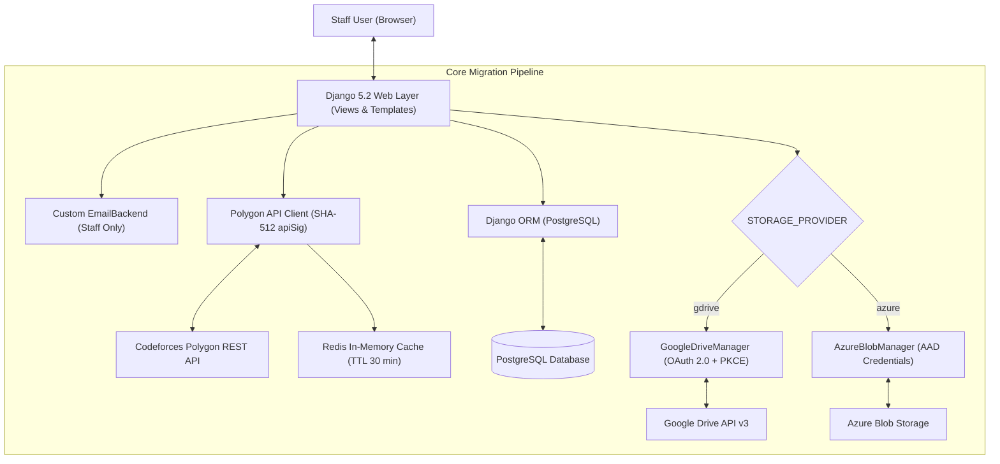

# AlgoUniversity Polygon Problem Migration System

A Django-based problem migration system that automates extracting, transforming, and persisting competitive programming contest problems from **Codeforces Polygon** into a relational database (**PostgreSQL**) and cloud object storage (**Google Drive** or **Azure Blob Storage**).

---

## 1. Problem Statement & Project Objectives

Managing programming contest problems across platforms involves error-prone manual exports, statement formatting issues, and test-case synchronization problems.

This system provides a reliable, automated pipeline to:
1. **Extract & Parse**: Fetch problem statements, metadata, solutions, custom checkers, and full test sets from Codeforces Polygon API using cryptographic request signing (`apiSig`).
2. **Guarantee Data Integrity**: Preserve exact test-case inputs and outputs without character truncation (solving previous 260-char limits), preserving critical whitespace/newlines, and retaining valid empty strings (`""`).
3. **Synchronize Reliably**: In-place update existing test cases and automatically prune obsolete/stale records when tests are removed on Polygon.
4. **Prevent Name Collisions**: Deterministically handle identical problem titles using collision-resistant unique slug generation (`generate_unique_slug`).
5. **Support Flexible Cloud Storage**: Support both **Google Drive** (via OAuth 2.0 Web Application with PKCE) and **Azure Blob Storage**, uploading test cases into standardized logical hierarchies (`test_cases/{problem_id}/{test_number:02d}` and `{test_number:02d}.a`).
6. **Protect API Quotas**: Cache raw test cases in **Redis** with a 30-minute TTL to prevent API rate-limiting (`HTTP 429 Too Many Requests`).

---

## 2. Key Features

- **Polygon API Ingestion**: Interacts with Codeforces Polygon REST API, downloading compiled packages and parsing statement HTML via `lxml`.
- **Staff-Only Access Control**: Custom email-based authentication (`EmailBackend`) restricting all migration actions to authorized staff users.
- **Redis Caching**: Test cases are cached in-memory during preview, eliminating redundant API calls when migrating to the database or cloud storage.
- **Full-Fidelity PostgreSQL Persistence**: Stores problem definitions, difficulty tiers, dynamic tag associations, and full-length test cases.
- **Synchronized Test Case Pruning**: Automatically purges stale test cases in PostgreSQL when Polygon's active test set count decreases.
- **Google Drive Storage (OAuth 2.0 + PKCE)**: Secure user authentication for personal Gmail accounts, overcoming zero-quota limitations of service accounts. Automatically refreshes access tokens and persists credentials.
- **Azure Blob Storage Support**: Multi-cloud compatibility allowing seamless provider switching via `STORAGE_PROVIDER`.
- **Custom Checker Compilation**: Automatically detects, downloads, and compiles C++ checkers (`g++ -std=gnu++17 -O2`) into executable binaries, falling back to C++ source code if compilation tools are absent.
- **Comprehensive Automated Test Suite**: 50 unit and integration tests covering data integrity, migrations, slug generation, token exchange, and cloud storage mocking.

---

## 3. System Architecture



---

## 4. Technology Stack

- **Backend Framework**: Python 3.12, Django 5.2
- **Database**: PostgreSQL (via `psycopg2-binary`)
- **Caching**: Redis 6+ / 7+ (via `redis-py`)
- **Cloud Storage**: Google Drive API v3 (`google-api-python-client`, `google-auth-oauthlib`, `google-auth-httplib2`), Azure Blob Storage (`azure-storage-blob`)
- **HTML Parsing**: `lxml`, `beautifulsoup4`
- **Environment Management**: `python-dotenv`
- **Testing**: Django Test Framework, `unittest.mock`

---

## 5. Prerequisites

Before installing the project, ensure the following services are available locally:
- **Python**: Version `3.10` or higher
- **PostgreSQL**: Running locally on port `5432`
- **Redis**: Running locally on port `6379`
- **C++ Compiler (Optional)**: `g++` on system `PATH` for compiling custom Polygon checkers
- **Google Cloud Console**: An OAuth 2.0 Client ID of type **Web application** (if using Google Drive)

---

## 6. Local Installation & Setup

### 1. Clone Repository & Navigate
```bash
git clone https://github.com/virajkushwaha/PolygonMigrationAssignment.git
cd PolygonMigrationAssignment
```

### 2. Create and Activate Virtual Environment
```bash
# Create virtual environment inside PolygonMigration/
python -m venv PolygonMigration/.venv

# Activate on Windows (PowerShell):
.\PolygonMigration\.venv\Scripts\Activate.ps1
# On Windows (cmd.exe): .\PolygonMigration\.venv\Scripts\activate.bat
# On Linux / macOS: source PolygonMigration/.venv/bin/activate
```

### 3. Install Dependencies
```bash
python -m pip install --upgrade pip
python -m pip install -r requirement.txt
python -m pip check
```

---

## 7. Environment Configuration (`.env`)

Copy the template configuration file to `PolygonMigration/.env`:
```bash
cp PolygonMigration/.env.example PolygonMigration/.env
```

Configure your local credentials in `PolygonMigration/.env`:

```env
# Django Settings
SECRET_KEY=your-django-secret-key
DEBUG=True
ALLOWED_HOSTS=localhost,127.0.0.1

# PostgreSQL Configuration
DB_NAME=polygon_migration
DB_USER=postgres
DB_PASSWORD=your_password
DB_HOST=localhost
DB_PORT=5432

# Redis Cache
REDIS_HOST=localhost
REDIS_PORT=6379
REDIS_PASSWORD=
REDIS_SSL=False

# Polygon API
POLYGON_API_KEY=your_polygon_api_key
POLYGON_API_SECRET=your_polygon_api_secret

# Cloud Storage Selection: 'gdrive' or 'azure'
STORAGE_PROVIDER=gdrive

# Google Drive (OAuth 2.0 Web Application)
GOOGLE_DRIVE_OAUTH_CLIENT_FILE=path/to/client_secret.json
GOOGLE_DRIVE_TOKEN_FILE=google_drive_token.json
GOOGLE_DRIVE_FOLDER_ID=your_google_drive_folder_id
GOOGLE_DRIVE_REDIRECT_URI=http://localhost:8000/oauth2callback/

# Azure Blob Storage (if STORAGE_PROVIDER=azure)
AZURE_STORAGE_ACCOUNT_URL=https://<your-account>.blob.core.windows.net/
AZURE_TENANT_ID=your-tenant-id
AZURE_CLIENT_ID=your-client-id
AZURE_USERNAME=your-azure-username
AZURE_PASSWORD=your-azure-password
AZURE_CONTAINER_NAME=testcases
```

> [!IMPORTANT]
> Never commit `.env`, OAuth client secrets, or token files to version control. These patterns are strictly excluded by `.gitignore`.

---

## 8. Database Setup & Migrations

Ensure PostgreSQL is running, then execute migrations:

```bash
# Run database migrations
python PolygonMigration/manage.py migrate

# Verify zero unapplied migrations
python PolygonMigration/manage.py makemigrations --check --dry-run

# Create a staff administrator account
python PolygonMigration/manage.py createsuperuser
```

---

## 9. Running the Application

Start the local Django development server:
```bash
python PolygonMigration/manage.py runserver 127.0.0.1:8000
```

1. Open your browser at `http://127.0.0.1:8000/`.
2. Unauthenticated visitors are automatically redirected to `/users/login/`.
3. Sign in with the superuser credentials created above.

---

## 10. Automated Test Execution

Run the complete 50-test automated test suite:

```bash
python PolygonMigration/manage.py test problems
```

**Verified Test Coverage**:
- Test case data integrity (full input/output length, no truncation).
- Whitespace fidelity (no `.rstrip()` stripping).
- Edge-case empty test values (`""`).
- Test case synchronization and pruning of stale indices.
- Collision-resistant unique slug generation (`generate_unique_slug`).
- Google Drive OAuth authorization, PKCE `code_verifier` persistence, token refresh, and file uploads.
- Azure Blob Storage upload and blob deletion.

---

## 11. Polygon API Integration

All requests to Codeforces Polygon are cryptographically signed using SHA-512:
$$\text{to\_hash} = \text{rand\_prefix} + \text{"/"} + \text{method\_name} + \text{"?"} + \text{param\_str} + \text{"\#"} + \text{POLYGON\_API\_SECRET}$$
$$\text{apiSig} = \text{rand\_prefix} + \text{SHA512}(\text{to\_hash})$$

Methods utilized:
- `problem.info`: Problem title, time limit, memory limit.
- `problem.package`: Downloads standard binary package containing statement HTML (`problem.html`).
- `problem.tests`, `problem.testInput`, `problem.testAnswer`: Full test-set enumeration and raw data retrieval.
- `problem.checker`, `problem.viewFile`: Checker classification and C++ source code download.
- `problem.solutions`, `problem.viewSolution`: Primary accepted solution retrieval (`tag='MA'`).

---

## 12. Google Drive OAuth 2.0 Setup

Because Google Service Accounts have 0 bytes storage quota on personal Gmail accounts, the system utilizes the **Google OAuth 2.0 Web Application Flow with PKCE (RFC 7636)**:

1. **Google Cloud Console Setup**:
   - Create a project in Google Cloud Console.
   - Enable the **Google Drive API**.
   - Configure the OAuth Consent Screen (add your email as a Test User).
   - Create credentials: **OAuth client ID** $\rightarrow$ Application type: **Web application**.
   - Add Authorized redirect URI: `http://localhost:8000/oauth2callback/`.
   - Download the client secrets JSON and specify its path in `GOOGLE_DRIVE_OAUTH_CLIENT_FILE`.
2. **Authorization**:
   - In the web dashboard, click **Authorize Google Drive**.
   - Complete Google's authorization consent screen.
   - The authorization code is securely exchanged using PKCE and persisted to `google_drive_token.json`.
3. **Automatic Refresh**:
   - Expired access tokens are refreshed automatically before upload operations using `credentials.refresh(Request())`.

---

## 13. Cloud Storage Logical Hierarchy

Both Google Drive and Azure Blob Storage enforce the assignment's required logical folder layout:
```text
test_cases/
└── {db_problem_id}/
    ├── 01                    # Test case 1 input
    ├── 01.a                  # Test case 1 output
    ├── 02                    # Test case 2 input
    ├── 02.a                  # Test case 2 output
    └── custom_checker.exe    # Compiled checker binary (or custom_checker.cpp)
```

---

## 14. Repository Structure

```
PolygonMigrationAssignment/
├── .gitignore                    # Git tracking ignore rules (secrets, venv, caches)
├── BASELINE_TEST_REPORT.md       # Baseline execution audit and real-world defect log
├── DOCUMENTATION.md              # Exhaustive system architecture and workflow documentation
├── issue.md                      # Detailed technical bug investigations and root cause analyses
├── ISSUES_TEMPLATE.md            # Original assessment issue analysis template
├── README.md                     # Project overview, architecture, and setup instructions (this file)
├── requirement.txt               # Pinned project Python dependencies
└── PolygonMigration/             # Django project root directory
    ├── manage.py                 # Django management CLI
    ├── .env                      # Local environment configuration file (gitignored)
    ├── .env.example              # Template environment variable file
    ├── google_drive_token.json   # Persisted Google OAuth refresh token (gitignored)
    ├── static/                   # Static CSS and JavaScript assets
    ├── logs/                     # Runtime application log files
    ├── PolygonMigration/         # Core project configuration package (settings, URLs, WSGI)
    ├── problems/                 # Problem migration application (views, models, polygon API, tests)
    │   ├── GoogleDriveStorage.py # Google Drive OAuth manager & file upload service
    │   ├── AzureTestcase.py      # Azure Blob Storage manager
    │   ├── polygon_api.py        # Polygon API service class & SHA-512 signing
    │   ├── models.py             # Problem, SampleTestCase, ProblemTestCase, ProblemTag
    │   ├── views.py              # Problem views, OAuth endpoints, sync logic
    │   ├── tests.py              # 50 automated unit & integration tests
    │   ├── migrations/           # Database migration files
    │   └── templates/problems/   # Bootstrap 5 migration dashboard templates
    ├── users/                    # User authentication application (custom EmailBackend)
    └── contents/                 # Topic and content models
```

---

## 15. Security Considerations

- **Credential Isolation**: `.env`, OAuth client secrets, and Google Drive token files are gitignored and never tracked.
- **CSRF & PKCE Hardening**: All OAuth authorization requests generate unique state and code verifiers stored in server-side session cookies to prevent cross-site request forgery and authorization code interception attacks.
- **Staff-Only Boundaries**: All problem extraction, database modification, and cloud storage endpoints are protected by `@user_passes_test(lambda u: u.is_authenticated and u.is_staff)`.
- **SQL & Parameter Injection Defense**: All database queries are executed via Django's parameterized ORM; all Polygon API queries are strictly parameter-encoded.

---

## 16. Known Limitations & Manual Verification

- **Google OAuth App Verification**: In "Testing" mode, Google OAuth refresh tokens expire after 7 days. Switching the OAuth app to "In Production" in Google Cloud Console is required for permanent refresh tokens.
- **Azure Live Credentials**: Live Azure Blob Storage upload requires an active Azure Active Directory subscription and storage container.
- **C++ Compiler Dependency**: Compiling custom checkers locally requires `g++`. On environments without `g++`, the system automatically falls back to uploading the raw C++ source file.

---

## 17. Additional Documentation

- For exhaustive technical deep-dives into all five workflows, cryptographic algorithms, and database queries, refer to [DOCUMENTATION.md](DOCUMENTATION.md).
- For root cause analyses and fixes for the 9 technical issues encountered during development, refer to [issue.md](issue.md).
